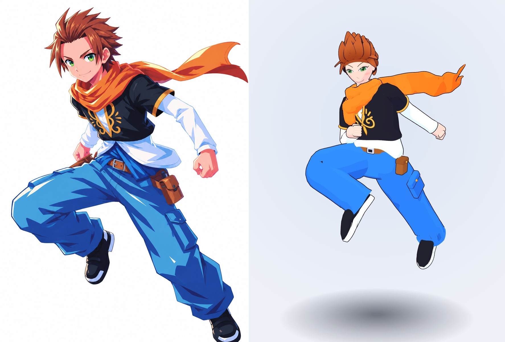

# スカーフの少年 3Dモデル

リファレンスのイラスト(オレンジのスカーフ、黒いチュニックに白いシャツ、青いカーゴパンツ、緑の目とツンツンした赤茶の髪で、跳びながら踏み込むポーズ)をもとに作った、**ボーン入りの3Dキャラクター**です。
Three.js でプログラム生成しているので、形・色・ポーズをコードから調整できます。



## ファイル

| ファイル | 内容 |
| --- | --- |
| `dist/character_pose.glb` | リファレンスと同じ「ジャンプ」ポーズのモデル(ボーン入り) |
| `dist/character_apose.glb` | Aポーズ(バインドポーズ)のモデル(ボーン入り)。アニメーション付けやリターゲットはこちら |
| `dist/viewer.html` | ブラウザで回して見られるビューア。単体で動作し、GLB の保存もできる |
| `previews/` | 正面・斜め・横・背面の画像と、リファレンスとの比較 (`comparison.jpg`) |

## 仕様

- 形式は glTF 2.0 (GLB)。単位はメートル、+Y が上、+Z が正面(glTF の標準)。
- 身長は約 1.72 m(髪の先まで含めると約 1.86 m)。
- 89,273 三角形。メッシュ1つ、マテリアル13種、テクスチャ2枚(顔、胸の紋章)。
- スケルトンは 28 ボーン。名前は Unity の Humanoid に割り当てやすい形にしてあります。
  - 体: `Hips` `Spine` `Chest` `UpperChest` `Neck` `Head`
  - 腕: `Left/Right` + `Shoulder` `UpperArm` `LowerArm` `Hand`
  - 脚: `Left/Right` + `UpperLeg` `LowerLeg` `Foot` `Toes`
  - スカーフの尾: `Scarf1` から `Scarf6`(風になびかせるための6本)
- 1頂点あたり最大4ウェイトのスキニングで、関節の周りは滑らかにブレンドします。
- 目・眉・口・ほおは顔に貼ったテクスチャ(`KHR_materials_unlit`)です。
- Khronos の glTF Validator で、エラー0・警告0です(`npm run validate`)。

## 開き方

- **Blender**: ファイル → インポート → glTF 2.0
- **Unity / Unreal / Godot**: GLB をそのままインポートします。
- **three.js**: `GLTFLoader` で読み込みます。
- **ビューア**: `dist/viewer.html` をブラウザで開きます。ドラッグで回転、スクロールやピンチで拡大します。ポーズ(ジャンプ / A)、視点、シェーディング(トゥーン / PBR)を切り替えられます。

ビューアのトゥーン表示と輪郭線は表示用の表現で、GLB には含まれません。GLB は標準的な PBR マテリアルです。

## 作り直し方

Node.js 18 以上と、書き出しにはヘッドレス Chromium(Playwright)が必要です。

```bash
cd character-3d
npm install
npm run build      # src/ から dist/viewer.html を生成
npm run export     # dist/*.glb と previews/*.jpg を書き出し
npm run validate   # GLB を検証
```

| ソース | 役割 |
| --- | --- |
| `src/character.js` | 頭・髪・服・パンツ・靴・スカーフなど全パーツの形状とスキニングの指定 |
| `src/rig.js` | ボーンの定義と、各セグメントの向きからポーズを合わせる処理 |
| `src/poses.js` | ポーズの定義(ここを変えるとポーズを調整できます) |
| `src/geo.js` | スイープ管、スキニング重み、デカール投影などの幾何ライブラリ |
| `src/materials.js` | トゥーン / PBR / 輪郭線のマテリアル |
| `src/textures.js` | 顔と紋章のテクスチャ(Canvas で描画) |
| `src/main.js` | ビューアと GLB 書き出し |

## 制約

- 画像1枚から自動で復元したものではありません。イラストを見ながら、形・色・ポーズをコードで再現したスタイライズモデルです。後頭部や背面など、イラストに写っていない部分は推測で作っています。
- 指のボーン、表情のブレンドシェイプ、髪を揺らすボーンはありません(両手は拳で固定)。動かせるのは体・腕・脚・首・頭とスカーフの尾です。
- 髪、服、靴は1つのメッシュにまとまっています(マテリアルごとにプリミティブが分かれています)。
